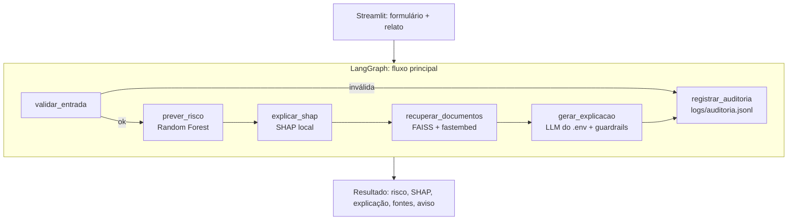

# 🛡️ Guardiã AI

**Apoio à triagem de risco materno com Machine Learning, RAG e LLM.**
Tech Challenge Fase 5 (Hackathon IADT, POSTECH). Grupo: Samuel, José, Jeff e Leo.

> ⚠ **A Guardiã AI é uma ferramenta de apoio.** Ela não faz diagnóstico, não prescreve medicamentos e não decide medidas de segurança. A decisão é sempre da profissional responsável.

## O problema

Instituições de atendimento à mulher recebem sinais vitais, formulários e relatos, e as profissionais analisam tudo à mão para identificar quem precisa de mais atenção. A Guardiã AI faz uma **análise inicial** do atendimento de uma gestante:

1. **classifica o risco materno** (baixo, médio, alto) a partir de sinais vitais, com um modelo de ML;
2. **explica o que pesou** na classificação (SHAP);
3. **busca orientações em documentos oficiais** (Ministério da Saúde, Lei Maria da Penha, Ligue 180), via RAG;
4. **gera uma explicação em linguagem clara** com uma LLM, citando a fonte de cada orientação e resumindo o relato, inclusive sinais de atenção ligados à segurança da mulher;
5. **registra tudo** num log de auditoria.

## Arquitetura



| Camada | Escolha | Por quê |
|---|---|---|
| ML | scikit-learn: Regressão Logística, Random Forest, HistGradientBoosting | 3 modelos comparados; nenhuma dependência extra |
| Explicabilidade | SHAP (TreeExplainer / LinearExplainer) | mostra o que pesou em cada predição |
| Orquestração | **LangGraph** | grafo explícito, com desvio para entrada inválida |
| RAG | FAISS + `fastembed` (MiniLM multilíngue, local) | funciona com qualquer provedor de LLM, inclusive os que não têm embeddings |
| LLM | `init_chat_model` do LangChain, configurada pelo `.env` | OpenAI, Gemini, Claude, Grok (xAI) ou Groq, sem mudar código |
| Interface | Streamlit | jornada completa numa tela |
| Auditoria | JSONL | uma linha por análise, inclusive rejeitadas e com erro |
| Deploy | Docker → Azure Container Apps / Render / AWS App Runner | ver [docs/deploy.md](docs/deploy.md) |

## Principais resultados

Dataset: *Maternal Health Risk* (UCI), com 1.014 linhas, das quais **562 eram duplicadas**. Removemos as duplicatas antes do split para evitar vazamento, e restaram **452 gestantes distintas**.

| Modelo | Recall alto risco (CV) | F1 macro (CV) | Recall alto risco (teste) | Precisão alto risco (teste) | Acurácia (teste) |
|---|---|---|---|---|---|
| Regressão Logística | 0,629 | 0,559 | 0,565 | 0,812 | 0,582 |
| **Random Forest** ✅ | **0,753** | **0,589** | **0,696** | **0,889** | 0,582 |
| HistGradientBoosting | 0,696 | 0,576 | 0,696 | 0,889 | 0,571 |

- **Métrica central: recall da classe alto risco.** Deixar passar uma gestante de alto risco é o erro mais caro. O vencedor é escolhido pela validação cruzada.
- **Sem deduplicar, o mesmo Random Forest chega a 0,945 de recall**, mas esse número é inflado por linhas repetidas no treino e no teste. Reportamos a estimativa honesta.
- Glicemia e pressão sistólica são os fatores que mais pesam (SHAP), o que é coerente com os protocolos do Ministério da Saúde.

Detalhes em [notebooks/01_eda_e_modelos.ipynb](notebooks/01_eda_e_modelos.ipynb) e no [relatório técnico](relatorio/relatorio.pdf).

## Como executar

### Com Docker (recomendado)

```bash
cp .env.example .env   # preencha LLM_PROVIDER, LLM_MODEL e a chave do provedor
```

```bash
docker build -t guardia-ai .
```

```bash
docker run --rm -p 8501:8501 --env-file .env guardia-ai
```

Abra http://localhost:8501. O build treina o modelo e gera o índice do RAG (~5 min). O container usa ~900 MB de RAM.

### Local (com [uv](https://docs.astral.sh/uv/))

```bash
uv sync
```

```bash
uv run python -m guardia.ml.train && uv run python -m guardia.rag.ingest
```

```bash
uv run streamlit run app.py
```

### Sem chave de LLM

A app funciona em **modo degradado**: mostra risco, SHAP e fontes, mas não gera o texto da LLM. É útil para avaliar sem custo.

### Testes

```bash
uv run pytest
```

Os 34 testes cobrem: validação de entrada, predição, SHAP, RAG, guardrails do prompt (relato com instruções maliciosas, aviso final sempre presente), provedores sem chave, falha da LLM, auditoria em todos os caminhos e os exemplos da demo.

## Segurança e responsabilidade

- **Dados:** dataset público e anonimizado (UCI, CC BY 4.0). Os exemplos e relatos da demo são **sintéticos**.
- **IA como apoio:** banner fixo na interface, e um aviso final anexado pelo código em toda explicação, sem depender da LLM.
- **Guardrails no prompt:** usar só o resultado do modelo e os trechos recuperados, citar `[arquivo, p. X]`, dizer quando falta informação, nunca dar diagnóstico definitivo, medicamento/dose ou decisão de segurança. O relato é tratado como **dado**, não como instrução (proteção contra prompt injection).
- **Sinais de atenção:** se o relato menciona agressão, ameaça ou medo, o RAG traz também os protocolos da rede de atendimento (Ligue 180, Lei Maria da Penha) para a profissional **considerar**. Nada é decidido automaticamente.
- **Auditoria:** cada análise grava entradas (inclusive o relato), predição, SHAP, fontes, texto da LLM, provedor/modelo e timestamp. Tentativas rejeitadas e falhas também são registradas. Como a demo publicada não tem login, o log pode ser baixado por quem acessar a URL; por isso, na demo, só dados sintéticos.

## Estrutura

```
├── app.py                    # interface Streamlit
├── src/guardia/
│   ├── ml/train.py           # treino e comparação dos modelos
│   ├── ml/predict.py         # predição, validação de faixas, SHAP
│   ├── rag/ingest.py         # documentos -> índice FAISS
│   ├── rag/retrieve.py       # busca
│   ├── llm.py                # LLM escolhida pelo .env
│   ├── prompts.py            # prompt com guardrails
│   ├── graph.py              # fluxo LangGraph
│   ├── audit.py              # log de auditoria
│   └── examples.py           # casos sintéticos da demo
├── data/                     # dataset (UCI)
├── knowledge_base/           # documentos públicos + FONTES.md
├── notebooks/                # EDA e comparação
├── tests/
├── docs/deploy.md            # deploy manual (Azure, Render, AWS)
├── docs/roteiro-video.md     # roteiro do vídeo
├── relatorio/                # relatório técnico (md + pdf)
└── Dockerfile
```

## Atendimento aos requisitos

| Requisito | Onde |
|---|---|
| Receber dados da atendida (RF01) | formulário + relato em `app.py` |
| Dataset, EDA e preparação (RF02–03) | `data/`, notebook, `train.py` (deduplicação) |
| ≥ 2 modelos e métricas além da acurácia (RF04–06) | 3 modelos, recall/precisão/F1, discussão de FN vs FP |
| Explicabilidade (RF07) | SHAP local na app e global no notebook |
| LLM (RF08) | `llm.py`, `prompts.py` |
| Base de conhecimento e RAG com fonte (RF09–11) | `knowledge_base/`, `rag/`, citações `[arquivo, p. X]` |
| LangGraph (RF12) | `graph.py` |
| Resultado para a profissional (RF13) | aba "Nova análise" |
| Dados públicos/sintéticos, IA como apoio, guardrails, auditoria (RNF01–06) | ver "Segurança e responsabilidade" |
| Repositório, notebook, README, app, Dockerfile, relatório, vídeo (ENT01–08) | este repositório; vídeo: *link a incluir após a gravação* |

## Limitações

Dataset pequeno e de uma única região (Bangladesh), sem validação clínica no Brasil. O recall de alto risco fica em ~0,70, então cerca de 3 em cada 10 casos de alto risco não são sinalizados pelo modelo, e por isso ele é apenas apoio. A LLM pode errar, embora fique restrita aos trechos citados. O log de auditoria se perde a cada deploy na nuvem. A busca de sinais de atenção no relato usa uma lista de termos e pode trazer protocolos em casos benignos. Detalhes no relatório.

## Licenças das fontes

Dataset: CC BY 4.0 (UCI). Documentos da base: ver [knowledge_base/FONTES.md](knowledge_base/FONTES.md).
